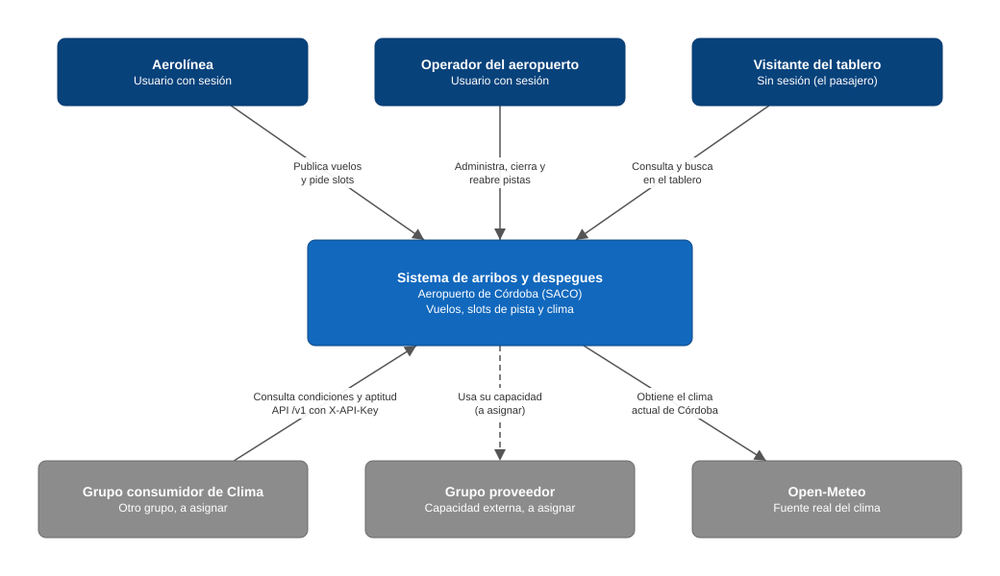
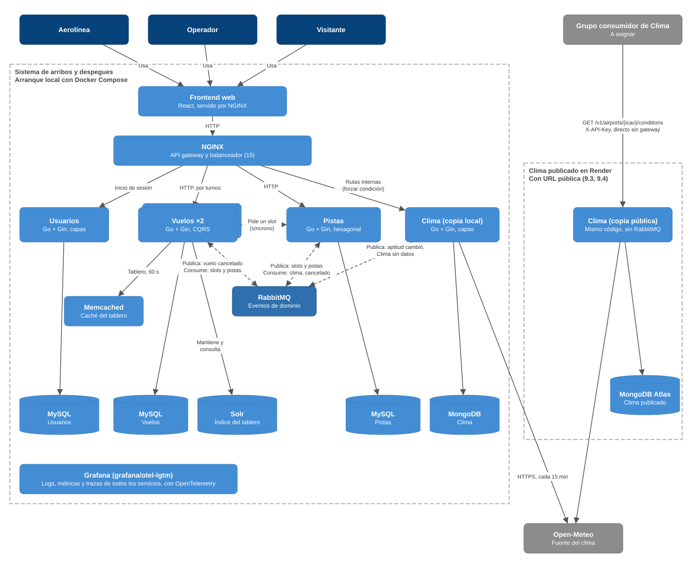

# Arquitectura

Cómo está armado el sistema: qué servicios tiene, de qué se ocupa cada uno, qué datos guarda, cómo se comunican y dónde corre cada pieza.

Todo lo que se describe acá sale de [decisiones.md](decisiones.md) y de los ADR en [adr/](adr/). Lo que todavía no está decidido figura como "a definir" y se junta en [Pendiente](#pendiente).

## El sistema, en un párrafo

Un sistema para administrar los arribos y despegues del aeropuerto de Córdoba (`SACO`). Las aerolíneas publican sus vuelos y piden un slot de pista para cada uno; el operador del aeropuerto administra las pistas; cualquiera puede ver el tablero de arribos y partidas. El clima puede cerrar las pistas, y eso demora los despegues y desvía los arribos. El servicio de clima es, además, la capacidad que publicamos para otro grupo.

El alcance, las reglas de negocio y los criterios de aceptación están en [SPEC.md](../SPEC.md).

## Diagrama de contexto

El sistema visto como una sola caja: quién lo usa y con qué sistemas externos habla.

| Quién | Qué hace con el sistema |
|---|---|
| **Aerolínea** | Inicia sesión, publica sus arribos y despegues y pide un slot para cada uno. |
| **Operador del aeropuerto** | Inicia sesión, administra las pistas, las cierra y las reabre a mano, y puede forzar una condición de clima. |
| **Visitante del tablero** | Consulta y busca en el tablero sin iniciar sesión. Es el caso del pasajero. |
| **Grupo consumidor de Clima** | Otro grupo de la materia, todavía no asignado. Consulta las condiciones y la aptitud de Córdoba con el contrato de [contracts/](contracts/README.md). |
| **Grupo proveedor** | Otro grupo, todavía no asignado, cuya capacidad usamos en un flujo importante. |
| **Open-Meteo** | La fuente real del clima (decisión 6.8). |

## Diagrama de contenedores

Las piezas que corren por separado y cómo se conectan. Las líneas punteadas son eventos por RabbitMQ; las continuas, llamadas directas.

| Contenedor | Tecnología | Para qué está |
|---|---|---|
| Frontend web | React | La interfaz de la aerolínea, el operador y el visitante. Todo lo que hacen pasa por acá. Lo sirve el mismo NGINX (15.7). |
| API gateway y balanceador | NGINX (15.1) | Un solo contenedor con dos archivos de configuración, uno por rol (15.3). Como gateway es el punto de entrada único de nuestros usuarios: verifica el token, dirige cada pedido a su servicio y limita el tráfico. Como balanceador reparte los pedidos entre las dos instancias de Vuelos. Ver [API gateway](#api-gateway). |
| Vuelos, dos instancias | Go con Gin | Ver [Servicios](#servicios). Corre en dos instancias detrás de NGINX (12.1). |
| Pistas | Go con Gin | Ver [Servicios](#servicios). |
| Clima, copia local | Go con Gin | Ver [Servicios](#servicios). Le avisa a Pistas por RabbitMQ (9.3). |
| Clima, copia pública | Go con Gin, en Render | El mismo código que la copia local, publicado para el grupo consumidor. No usa RabbitMQ (9.3, 9.4). |
| Usuarios | Go con Gin | Ver [Servicios](#servicios). |
| MySQL de Vuelos, de Pistas y de Usuarios | MySQL | Una instancia por servicio (5.2, ADR-003). |
| MongoDB de Clima | MongoDB | Observaciones y aptitud del aeropuerto (ADR-003). La copia pública usa MongoDB Atlas, plan gratuito (9.7). |
| Índice del tablero | Solr | Búsqueda del tablero. Lo mantiene Vuelos a partir de eventos (3.2, 14). |
| Caché del tablero | Memcached | Guarda las consultas del tablero durante 60 segundos. La comparten las dos instancias de Vuelos (10). |
| Mensajería | RabbitMQ | Eventos de dominio entre servicios (ADR-005). |
| Observabilidad | Grafana (`grafana/otel-lgtm`) | Recibe los logs, las métricas y las trazas de todos los servicios, enviados con OpenTelemetry (11.1). Para no cargar el diagrama, no se dibujan esas flechas. |

Los diagramas son archivos `.drawio.svg`: GitHub los muestra como imagen y se editan abriéndolos con [draw.io](https://app.diagrams.net) o con la extensión "Draw.io Integration" de VS Code.

## Servicios

Son cuatro, más el API gateway. Ningún servicio lee ni escribe la base de otro (3.1). El porqué de estos límites está en el [ADR-001](adr/ADR-001.md).

| Servicio | Qué hace | De qué es dueño | Qué guarda de los otros | Organización interna |
|---|---|---|---|---|
| **Vuelos** | Publicar arribos y despegues, seguir su estado y buscarlos en el tablero. | Datos del vuelo: tipo de operación, aerolínea, origen, destino, horario, estado. | El identificador del slot asignado. | CQRS |
| **Pistas** | Asignar slots de aterrizaje y de despegue sin que se pisen. Cerrar y reabrir pistas. | Pistas, bloques de tiempo y qué vuelo ocupa cada uno. | El identificador del vuelo, su tipo de operación y la última aptitud informada por Clima. | Hexagonal |
| **Clima** | Informar las condiciones y si se puede operar. Es lo que se publica. | Observaciones de clima y umbrales de aptitud. | Nada. | Capas |
| **Usuarios** | Guardar los usuarios y entregar los tokens. | Usuarios y credenciales. | Nada. | Capas |

Las organizaciones internas son las decisiones 7.3 (Vuelos, Pistas y Clima) y 7.5 (Usuarios). Las carpetas de cada servicio están descritas en el `README.md` de su carpeta en [services/](../services/).

## Datos

Cada servicio levanta su propio servidor de base de datos (5.2). El detalle está en el [ADR-003](adr/ADR-003.md).

| Servicio | Almacenamiento | Por qué |
|---|---|---|
| Vuelos | MySQL | Estados y transiciones con estructura fija. |
| Pistas | MySQL | "Un slot, un solo vuelo" se apoya en una restricción única de la base. |
| Clima | MongoDB | Muchas observaciones, sin relaciones entre sí. |
| Usuarios | MySQL (5.3) | Forma fija y nombre de usuario que no se puede repetir. |

Solr y Memcached guardan copias derivadas de los vuelos para el tablero; no son fuente de verdad. Entre servicios no hay claves foráneas: lo que un servicio sabe de otro (por ejemplo, el slot de un vuelo) le llega por eventos, y puede estar desactualizado por un momento.

## Comunicación

El detalle, con timeouts, reintentos e idempotencia, está en el [ADR-005](adr/ADR-005.md).

**Llamada directa.** Hay una sola entre servicios propios: Vuelos le pide a Pistas un slot exacto con `POST /internal/slots` y espera la respuesta (4.1, 4.15). Es una ruta interna: el gateway no la expone. Además, el frontend llega a cada servicio a través del gateway.

**Eventos.** Todo lo demás se avisa por RabbitMQ, publicado con Transactional Outbox (4.4), en el exchange `aeropuerto.eventos` (4.10). La clave de ruteo dice servicio, cosa y qué pasó, por ejemplo `pistas.slot.asignado` (4.14):

| Evento | Lo publica | Lo recibe |
|---|---|---|
| Slot asignado | Pistas | Vuelos |
| Slot liberado por cierre | Pistas | Vuelos |
| Slot cedido a un arribo | Pistas | Vuelos |
| Pista cerrada / reabierta | Pistas | Vuelos |
| Aptitud operativa cambió | Clima | Pistas |
| Clima sin datos | Clima | Pistas |
| Vuelo cancelado | Vuelos | Pistas |

"Clima sin datos" se suma en la Entrega 2 (pendiente 17 de la sección 18): avisa que Clima no puede obtener el clima, para que Pistas muestre el aviso y el operador decida a mano (6.19).

**Hacia afuera.** El grupo consumidor llama directo a la copia pública de Clima, en Render, con `GET /airports/{icao}/conditions` y su clave en `X-API-Key` (ADR-015). Por indicación del profe, la versión no va en la ruta: es el número del contrato (9.10). No pasa por nuestro gateway (9.9). Cuando consumamos la capacidad del grupo proveedor, la llamada va a salir del servicio dueño de la funcionalidad que la usa, nunca del frontend ni del gateway (enunciado, sección 4).

### Flujo principal: publicar un vuelo

1. La aerolínea publica un vuelo desde el frontend. El pedido llega a NGINX, que verifica su token y lo manda a una de las dos instancias de Vuelos.
2. Vuelos guarda el vuelo como "pendiente de slot".
3. Vuelos le pide a Pistas el slot elegido, con una llamada directa.
4. Pistas lo asigna si está libre y guarda el evento "slot asignado" en la misma transacción.
5. El relay de Pistas publica el evento en RabbitMQ.
6. Vuelos lo consume, pasa el vuelo a "programado" y actualiza el índice del tablero.

Si Pistas no responde, el vuelo queda "pendiente de slot" y la aerolínea puede volver a pedir. Si Pistas viene fallando seguido, el circuit breaker de Vuelos deja de llamarla durante un rato y los vuelos nuevos quedan directamente en "pendiente de slot" (13.1).

## API gateway

El gateway es el mismo NGINX que balancea (15.1). El profe recomendó separar los dos roles en dos archivos de configuración (15.3): `gateway.conf` y `balanceo.conf`, en la carpeta `nginx/` (20.2).

- **Rutas por prefijo (15.7).** `/api/vuelos/`, `/api/pistas/`, `/api/usuarios/` y `/api/clima/` van a cada servicio. Sin token pasan solo el inicio de sesión y el tablero. Solo NGINX expone un puerto hacia afuera.
- **Tokens (15.2, 15.4, 15.5).** Usuarios entrega un JWT que dura 1 hora y lleva el usuario, su rol, su aerolínea si es una, y el vencimiento. NGINX verifica la firma y el vencimiento con un script njs, sin preguntarle a Usuarios: si Usuarios se cae, las sesiones abiertas siguen funcionando.
- **Identidad hacia los servicios (15.6).** Después de verificar el token, NGINX manda `X-User-Id`, `X-User-Role` y `X-Airline`, y pisa los que vengan del cliente con esos nombres. El gateway autentica; cada servicio decide qué puede hacer ese usuario.
- **Control de tráfico (15.8).** 20 pedidos por segundo por IP, con ráfagas de hasta 40. Al pasarlo responde `429`.

La copia pública de Clima no está detrás de este gateway: tiene su propia clave y su propio límite de 60 pedidos por minuto (9.6).

## Distribución

**Arranque local.** Todo el sistema se levanta con Docker Compose ([docker-compose.yml](../docker-compose.yml)): los cuatro servicios, tres MySQL, un MongoDB, Solr y RabbitMQ. En la Entrega 2 se suma Grafana (11.1). NGINX, la segunda instancia de Vuelos, Memcached y el frontend llegan en noviembre ([entrega-2.md](entrega-2.md)).

**Clima en la nube.** El enunciado pide que la capacidad publicada esté en la nube con una URL pública. Clima corre en dos copias del mismo código (9.3):

- la **copia pública**, en Render con MongoDB Atlas (9.4, 9.7), atiende al grupo consumidor y no usa RabbitMQ;
- la **copia local**, en el Docker Compose, es la que le avisa a Pistas por eventos.

Así no se sube a la nube más de lo necesario. Las dos consultan a Open-Meteo cada 15 minutos por su cuenta (9.1, 9.2), así que pueden mostrar datos distintos durante unos minutos. No rompe nada, porque cada una atiende a un público distinto.

El grupo consumidor entra **directo a la copia pública**, sin pasar por nuestro gateway (9.9): Clima ya autentica con su propia clave y tiene su propio límite de pedidos (ADR-015), y así no hace falta desplegar el gateway en la nube. El gateway queda como punto de entrada único de nuestros usuarios. En el plan gratuito, Render duerme el servicio cuando no se usa, y el primer pedido después de un rato tarda cerca de un minuto (9.4).

**Balanceo.** NGINX reparte los pedidos por turnos entre dos instancias de Vuelos (12.1, 12.2). Se eligió Vuelos porque es el que más tráfico recibe y tiene el tablero cacheado, así que el balanceo y la caché se muestran sobre el mismo flujo. Por eso Vuelos no puede guardar nada importante en la memoria de una sola instancia, y la caché es un Memcached compartido (10.2).

## Pendiente

- **Punto de entrada único:** confirmar con el profe que la API pública de Clima puede no pasar por el gateway (9.9, enunciado 2.1).
- **Grupo proveedor:** qué capacidad consumimos, desde qué servicio y en qué flujo (F-19). Lo asigna la cátedra.
- **Grupo consumidor:** qué grupo usa nuestro Clima. Lo asigna la cátedra.
- **Limitaciones conocidas y deuda técnica aceptada:** sección que se agrega para la presentación.
